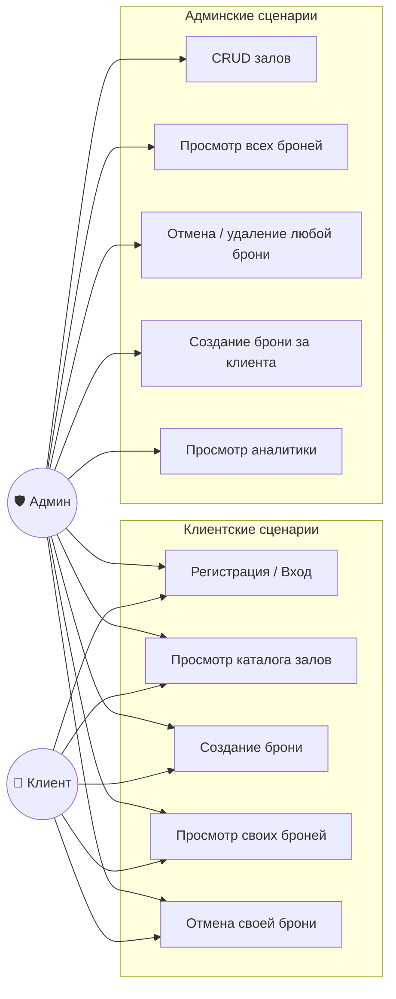
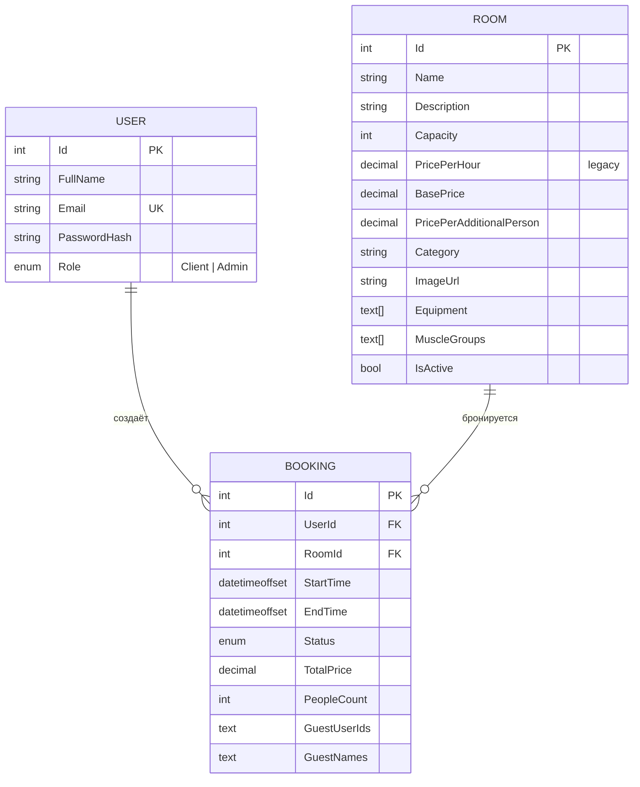

# Архитектура PrivateGym

Документ описывает системную модель приложения: роли, данные, компоненты, ключевые сценарии и состояния брони.

## Содержание
1. [Use Case](#1-use-case)
2. [ER-модель](#2-er-модель)
3. [Компоненты](#3-компоненты)
4. [Sequence: регистрация и вход](#4-sequence-регистрация-и-вход)
5. [Sequence: создание брони клиентом](#5-sequence-создание-брони-клиентом)
6. [Sequence: создание брони админом](#6-sequence-создание-брони-админом)
7. [Sequence: фоновое обновление статусов](#7-sequence-фоновое-обновление-статусов)
8. [Состояния Booking](#8-состояния-booking)
9. [Activity: процесс бронирования глазами клиента](#9-activity-процесс-бронирования-глазами-клиента)

---

## 1. Use Case


Пояснение. Диаграмма демонстрирует ролевую модель доступа (RBAC). Админ является расширением клиента: он обладает доступом ко всем базовым функциям (включая возможность бронировать залы для себя) плюс имеет эксклюзивные права на управление каталогом, аналитику и модерацию всех броней в системе. Регистрация через открытый эндпоинт всегда выдает роль Client; роль Admin назначается только вручную через базу данных.

2. ER-модель

Пояснение к модели данных. Схема описывает реляционную структуру PostgreSQL.

Связи: «Один-ко-многим» от Пользователя к Броням (пользователь может иметь много броней) и от Зала к Броням (зал может быть забронирован много раз).

Типы данных: Для массивов оборудования (Equipment, MuscleGroups) используются нативные типы PostgreSQL text[]. Время хранится в datetimeoffset (с часовым поясом) для корректной работы с разными регионами.

Замечания:

Room.PricePerHour — историческое поле (legacy). Цена сейчас считается динамически на основе BasePrice + PricePerAdditionalPerson * (People - 1).

Booking.GuestUserIds и GuestNames временно хранятся как CSV-строки (MVP-решение). В будущем планируется нормализация в отдельную таблицу.

Времена всех операций в коде приводятся к UTC.

3. Компоненты
```mermaid
graph TB
    subgraph Client_Layer [🌐 Клиентский слой]
        Browser[Браузер<br/>HTML + Vanilla JS<br/>+ ApexCharts]
    end

    subgraph App_Layer [⚙️ ASP.NET Core 8]
        API[Web API Controllers<br/>Auth / Rooms / Bookings / Admin]
        Auth[JWT Auth + BCrypt]
        BG[BookingStatusUpdateService<br/>BackgroundService]
    end

    subgraph Data_Layer [🗄️ Слой данных]
        EF[EF Core 8]
        PG[(PostgreSQL 15)]
    end

    Browser -- HTTPS + JWT --> API
    API --> Auth
    API --> EF
    Auth --> EF
    BG --> EF
    EF --> PG
   ```
Пояснение. Схема иллюстрирует классическую трехзвенную архитектуру (Three-Tier Architecture).

Клиентский слой не содержит бизнес-логики: это статические файлы, которые общаются с сервером по REST API, передавая JWT-токен в заголовках.

Слой приложения разделен на обработку HTTP-запросов (Controllers), проверку безопасности (Auth) и фоновые процессы (BackgroundService). Фоновый сервис работает в отдельном потоке и не блокирует обработку запросов пользователей.

Слой данных абстрагирован через Entity Framework Core, который транслирует C#-код в SQL-запросы к базе PostgreSQL.

4. Sequence: регистрация и вход
```mermaid
sequenceDiagram
    autonumber
    actor U as Клиент
    participant API as AuthController
    participant DB as PostgreSQL
    U->>API: POST /auth/register (email, password, fullName)
    API->>DB: SELECT user WHERE Email = ?
    DB-->>API: пусто
    API->>API: BCrypt.HashPassword()
    API->>DB: INSERT User (Role = Client)
    DB-->>API: OK
    API-->>U: 200 "Регистрация успешна"
    U->>API: POST /auth/login (email, password)
    API->>DB: SELECT user WHERE Email = ?
    DB-->>API: User
    API->>API: BCrypt.Verify()
    API->>API: JWT (id, role, exp = 7d)
    API-->>U: 200 { token, role, userId, fullName }
    U->>U: localStorage.setItem("token")
   ```
Пояснение. Диаграмма показывает stateless-авторизацию. При регистрации пароль не сохраняется в открытом виде, а хешируется алгоритмом BCrypt. При входе сервер генерирует JWT-токен (JSON Web Token), внутри которого зашифрованы ID пользователя и его роль. Клиент сохраняет токен в localStorage и впоследствии прикрепляет его к каждому запросу.

6. Sequence: создание брони клиентом
Проверка и вставка выполняются в одной сериализуемой транзакции. Это исключает гонку «два клиента одновременно видят слот свободным и оба вставляют бронь».

sequenceDiagram
    autonumber
    actor C as Клиент
    participant API as BookingsController
    participant DB as PostgreSQL

    C->>API: POST /bookings {roomId, start, end, people}
    API->>API: Валидация (start < end, start > now, 1 ≤ people ≤ capacity)
    API->>DB: Найти Room
    DB-->>API: Room
    API->>API: Рассчитать TotalPrice на сервере

    API->>DB: BEGIN ISOLATION LEVEL SERIALIZABLE

    API->>DB: SELECT booking WHERE RoomId=? AND Status!=Cancelled AND overlap
    alt Пересечение есть
        DB-->>API: конфликт
        API->>DB: ROLLBACK
        API-->>C: 409 Conflict
    else Свободно
        DB-->>API: пусто
        API->>DB: INSERT Booking (Status=Confirmed)
        API->>DB: COMMIT
        DB-->>API: OK
        API-->>C: 200 BookingResponse
    end
    ```
Пояснение. Ключевая особенность этого сценария — защита от состояния гонки (Race Condition). Уровень изоляции SERIALIZABLE гарантирует, что если два клиента одновременно попытаются забронировать один слот, база данных заблокирует одну из транзакций до ее завершения. Второй клиент гарантированно получит ошибку 409 Conflict и не сможет создать дублирующую бронь. Расчет стоимости происходит исключительно на бэкенде.

6. Sequence: создание брони админом
```mermaid
sequenceDiagram
    autonumber
    actor A as Админ
    participant API as AdminController
    participant DB as PostgreSQL
    A->>API: POST /admin/bookings {userId, roomId, start, end, guests}
    API->>API: Валидация
    API->>DB: Найти Room (должен быть IsActive)
    DB-->>API: Room
    API->>DB: Проверить, что UserId существует
    DB-->>API: User
    API->>API: Рассчитать TotalPrice на сервере

    API->>DB: BEGIN ISOLATION LEVEL SERIALIZABLE
    API->>DB: Проверить пересечение
    alt Зал занят
        API->>DB: ROLLBACK
        API-->>A: 409 Conflict
    else Свободен
        API->>DB: INSERT Booking (Status=Confirmed, UserId=клиента)
        API->>DB: COMMIT
        API-->>A: 200 { Id }
    end
   ```
Пояснение. Сценарий бронирования администратором за клиента. Отличается от клиентского флоу тем, что админ явно передает UserId (за кого создается бронь), может добавить список гостей (GuestUserIds, GuestNames), а также тем, что система проводит дополнительную проверку на существование клиента перед началом транзакции, чтобы вернуть понятную ошибку вместо FK constraint violation.

8. Sequence: фоновое обновление статусов
```mermaid
sequenceDiagram
    autonumber
    participant BG as BookingStatusUpdateService
    participant DB as PostgreSQL
    loop Каждые 5 минут
        BG->>DB: SELECT WHERE Status=Confirmed AND EndTime < NOW
        DB-->>BG: expiredBookings[]
        BG->>BG: Status = Completed
        BG->>DB: SaveChanges
        BG->>BG: LogInformation(updated count)
    end
   ```
Пояснение. Механизм автоматизации (Cron Job). Фоновый сервис (наследник BackgroundService в ASP.NET Core) просыпается каждые 5 минут, сканирует базу данных на предмет броней, время окончания которых уже прошло, и автоматически переводит их в статус Completed. Это обеспечивает актуальность статистики без участия человека.

10. Состояния Booking
```mermaid
stateDiagram-v2
    [*] --> Confirmed: создание клиентом / админом
    [*] --> Pending: (резерв, не используется)

    Pending --> Confirmed: подтверждение админом
    Pending --> Cancelled

    Confirmed --> Completed: EndTime прошёл (BackgroundService)
    Confirmed --> Cancelled: отмена клиентом / админом
    Confirmed --> NoShow: админ вручную

    Completed --> [*]
    Cancelled --> [*]
    NoShow --> [*]

    note right of Pending
        В текущей реализации не создаётся.
        Зарезервировано под сценарий
        «предзаявка с подтверждением».
    end note
    note right of Confirmed
        Основной рабочий статус.
        Участвует в проверке пересечений.
    end note
```
Пояснение. Диаграмма состояний (State Machine) описывает жизненный цикл бронирования. Бронь создается сразу в статусе Confirmed (занимает слот навсегда). Из этого статуса она может перейти в:

Completed — автоматически по истечении времени;

Cancelled — если клиент или админ отменили бронь (слот освобождается);

NoShow — если админ вручную отметил, что клиент не пришел.
(Статус Pending зарезервирован в коде для будущей фичи «брони с подтверждением», но пока не используется).

9. Activity: процесс бронирования глазами клиента
```mermaid
flowchart TD
    A([Начало]) --> B[Выбор зала из каталога]
    B --> C[Выбор даты]
    C --> D["GET /rooms/{id}/schedule"]
    D --> E{"Есть свободные слоты?"}
    E -- Нет --> C
    E -- Да --> F[Выбор одного или нескольких диапазонов]
    F --> G[Указание числа гостей]
    G --> H[Клиент видит итоговую цену]
    H --> I[Нажатие «Забронировать»]
    I --> J{"Для каждого диапазона:<br/>POST /bookings"}
    J -- 409 Conflict --> K[Ошибка: слот занят]
    K --> C
    J -- 200 OK --> L[Сервер пересчитывает цену]
    L --> M[Сохранение в БД]
    M --> N[Бронь в «Мои бронирования»]
    N --> O([Конец])
   ```
Пояснение. Блок-схема (User Journey) описывает пошаговый процесс бронирования. Особенность: клиент может выбрать как непрерывный диапазон, так и несколько отдельных часов (например, с 10 до 12 и с 15 до 17). В таком случае фронтенд отправит несколько запросов. Если в процессе бронирования сервер вернет ошибку (кто-то успел занять слот), пользователь будет возвращен к шагу выбора даты с уведомлением.
