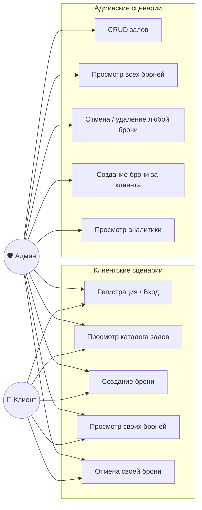
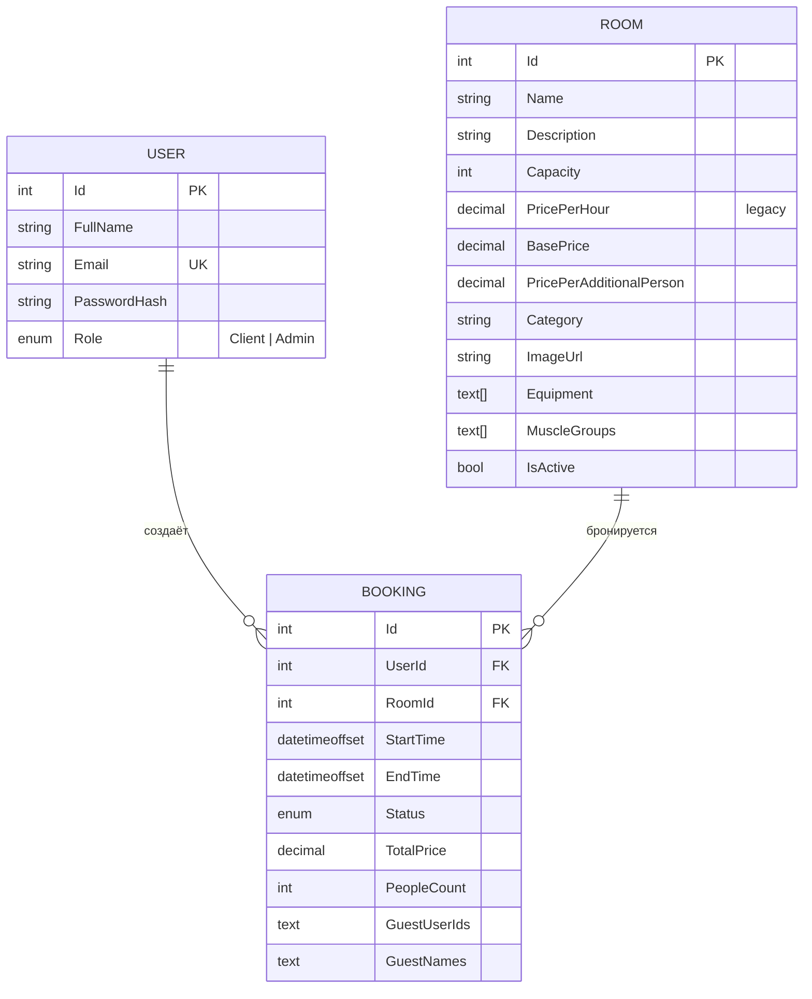
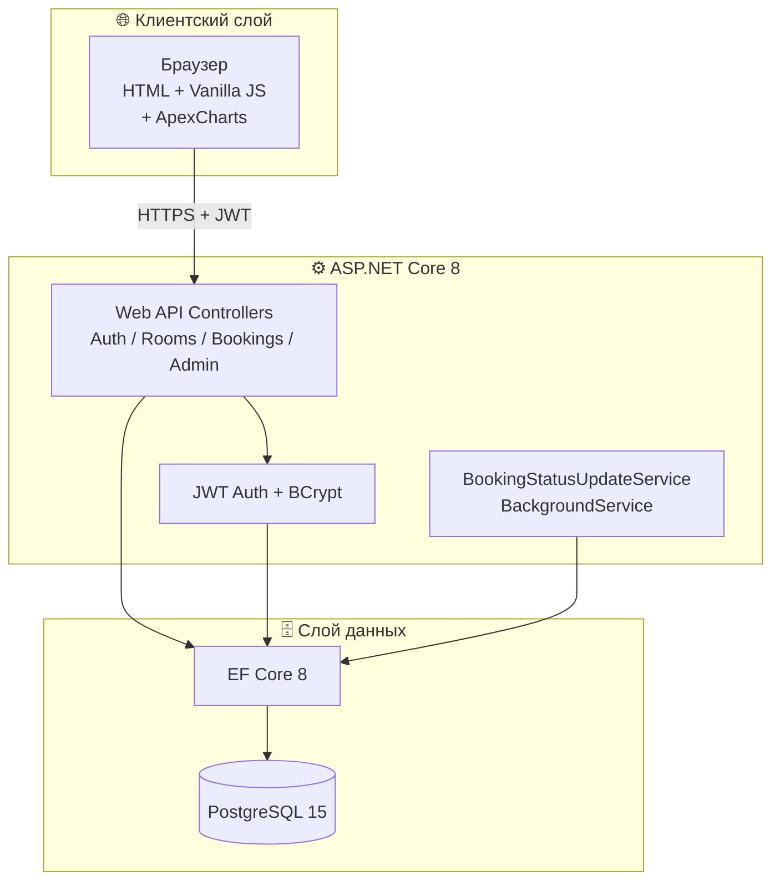
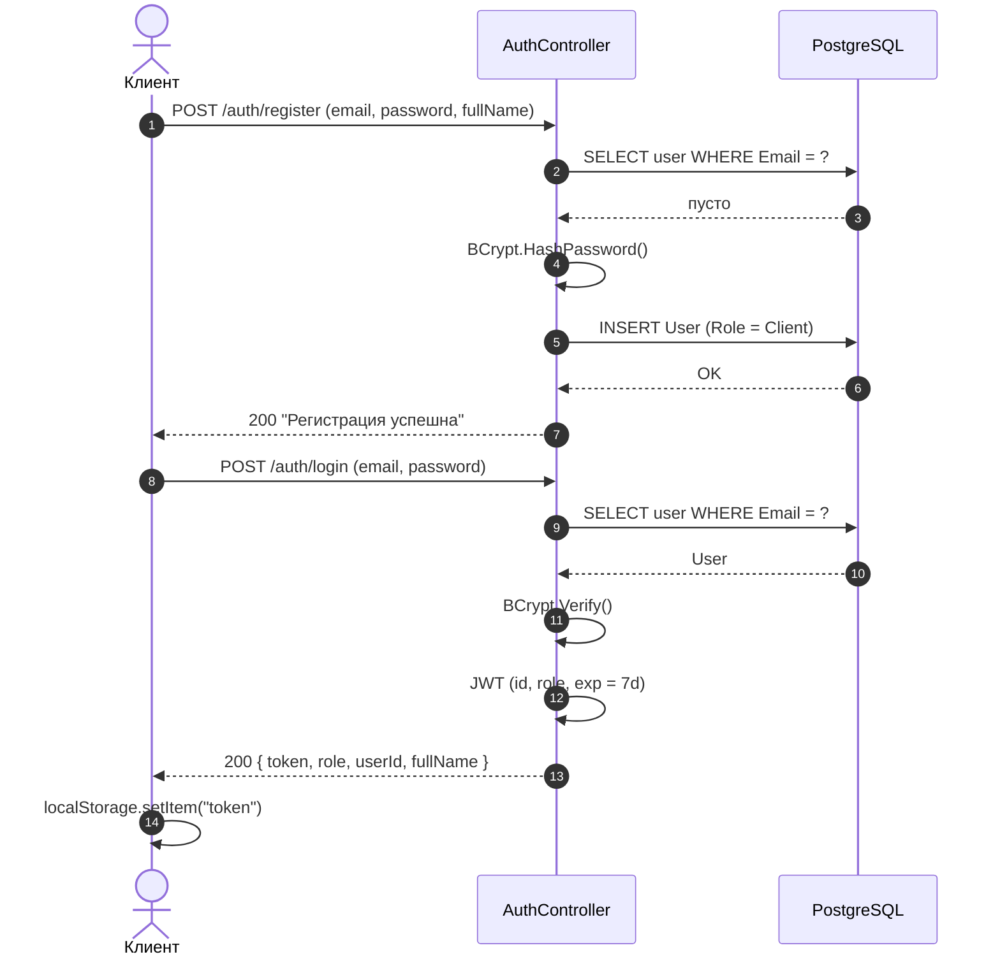
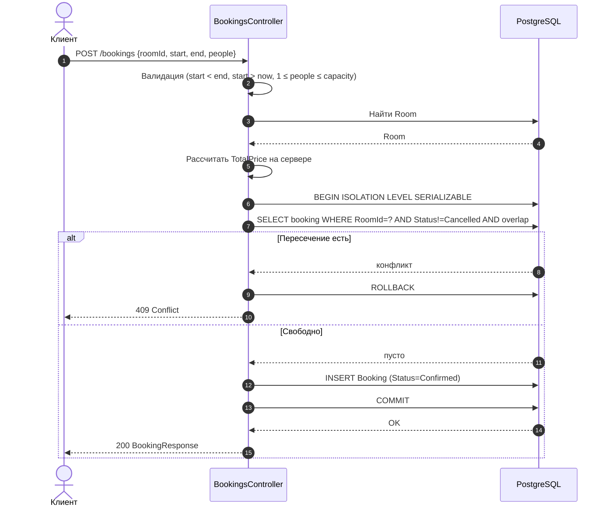
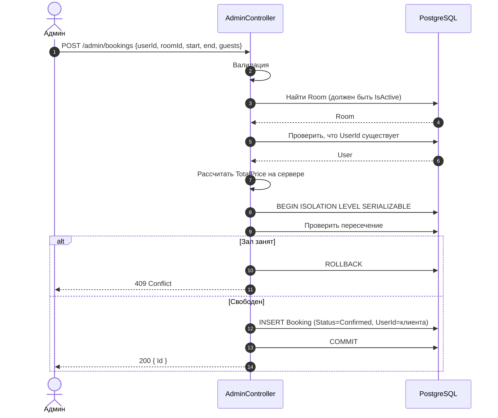
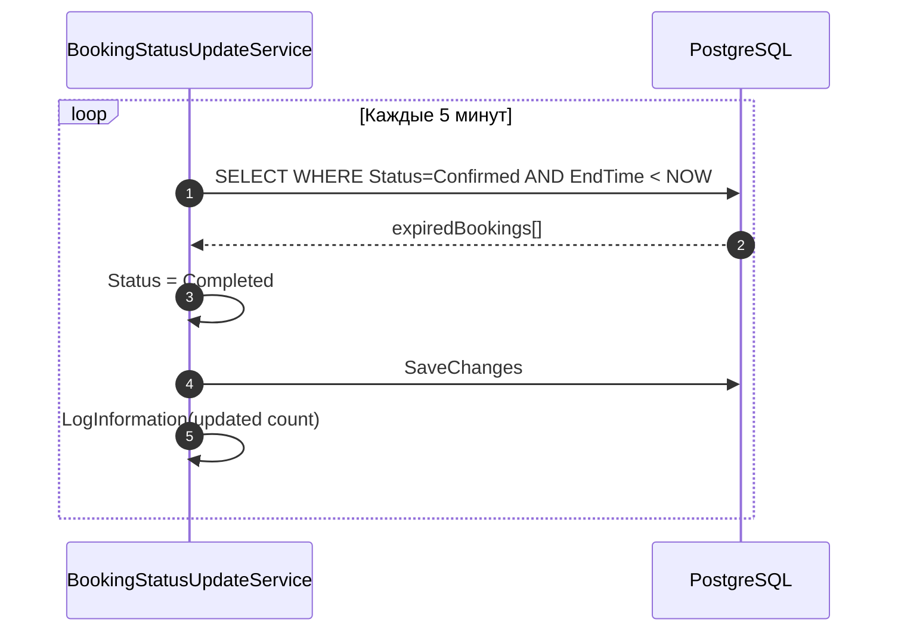
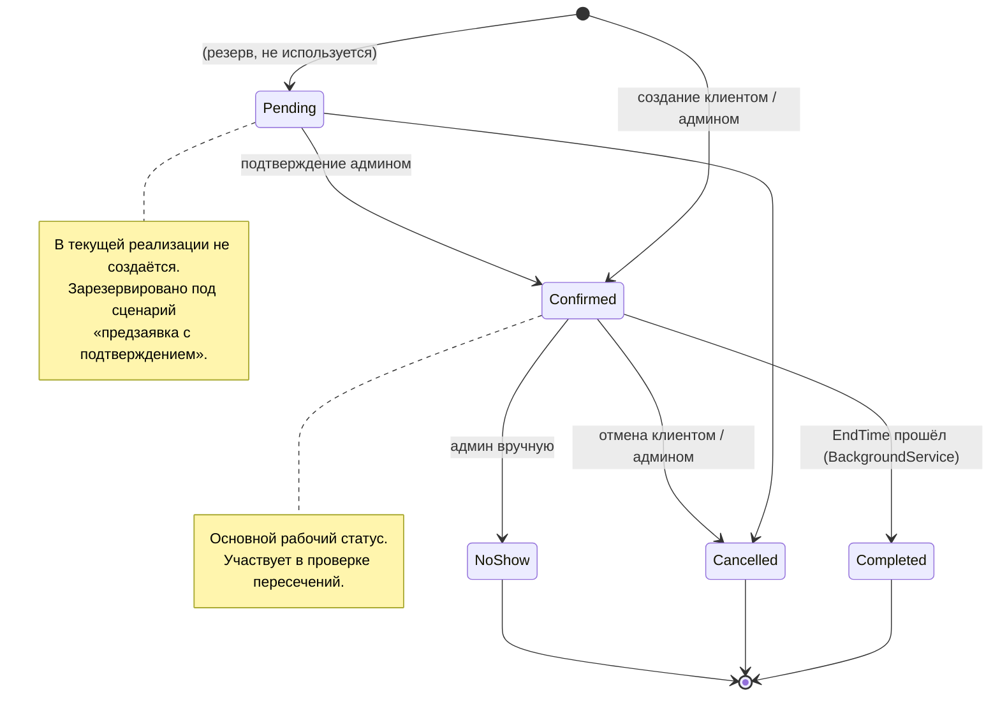

# Архитектура PrivateGym

Документ описывает системную модель приложения: роли, данные, компоненты, ключевые сценарии и состояния брони.

## Содержание
1. [Use Case](#1-use-case)
2. [ER-модель](#2-er-модель)
3. [Компоненты](#3-компоненты)
4. [Sequence: регистрация и вход](#4-sequence-регистрация-и-вход)
5. [Sequence: создание брони клиентом](#5-sequence-создание-брони-клиентом)
6. [Sequence: создание брони админом](#6-sequence-создание-брони-админом)
7. [Sequence: фоновое обновление статусов](#7-sequence-фоновое-обновление-статусов)
8. [Состояния Booking](#8-состояния-booking)
9. [Activity: процесс бронирования глазами клиента](#9-activity-процесс-бронирования-глазами-клиента)

---

## 1. Use Case



**Пояснение.** Админ — расширение клиента: он может всё то же самое (включая бронирование под собой) плюс административные сценарии. Регистрация через публичный эндпоинт всегда даёт роль `Client`; `Admin` назначается вручную через SQL.

---

## 2. ER-модель



**Замечания:**

- `Room.PricePerHour` — историческое поле, осталось от ранней версии. Цена теперь считается по `BasePrice + PricePerAdditionalPerson * (People - 1)`. Поле сохранено для совместимости и используется только в фильтре `maxPrice`.
- `Booking.GuestUserIds` и `Booking.GuestNames` — CSV-строки. Нормализация — в планах.
- `Booking.Status` — enum из 5 значений (`Pending`, `Confirmed`, `Cancelled`, `Completed`, `NoShow`). В текущей реализации `Pending` не создаётся.
- Времена хранятся как `datetimeoffset`. Все сравнения выполняются в UTC.

---

## 3. Компоненты



---

## 4. Sequence: регистрация и вход



---

## 5. Sequence: создание брони клиентом

Проверка и вставка выполняются в одной **сериализуемой транзакции**. Это исключает гонку «два клиента одновременно видят слот свободным и оба вставляют бронь».



**Особенность фронтенда.** Если пользователь выбирает несколько **несвязных** диапазонов (10:00–11:00 + 14:00–15:00), интерфейс делает **N последовательных** `POST /bookings` — по одному на каждый диапазон. Для связных (10:00–12:00) — один запрос. Упрощение с `POST /bookings/bulk` — в планах.

---

## 6. Sequence: создание брони админом



**Отличия от клиентского флоу:**
- Админ явно указывает `UserId` клиента.
- Может передать `GuestUserIds` и `GuestNames` (гости).
- Бронь создаётся сразу в статусе `Confirmed`.
- Дополнительная проверка существования `UserId` — чтобы не получить `FK constraint violation` вместо понятной ошибки.

---

## 7. Sequence: фоновое обновление статусов



**Пояснение.** Сервис работает в отдельном scope DI, получает `AppDbContext` через `IServiceProvider.CreateScope()` и не блокирует HTTP-запросы. Если при итерации произошла ошибка — она логируется, цикл продолжается через 5 минут.

---

## 8. Состояния Booking



---

## 9. Activity: процесс бронирования глазами клиента

```mermaid
flowchart TD
    A([Начало]) --> B[Выбор зала из каталога]
    B --> C[Выбор даты]
    C --> D[GET /rooms/{id}/schedule]
    D --> E{Есть свободные слоты?}
    E -- Нет --> C
    E -- Да --> F[Выбор одного или нескольких диапазонов]
    F --> G[Указание числа гостей]
    G --> H[Клиент видит итоговую цену]
    H --> I[Нажатие «Забронировать»]
    I --> J{Для каждого диапазона:<br/>POST /bookings}
    J -- 409 Conflict --> K[Ошибка: слот занят]
    K --> C
    J -- 200 OK --> L[Сервер пересчитывает цену]
    L --> M[Сохранение в БД]
    M --> N[Бронь в «Мои бронирования»]
    N --> O([Конец])
```