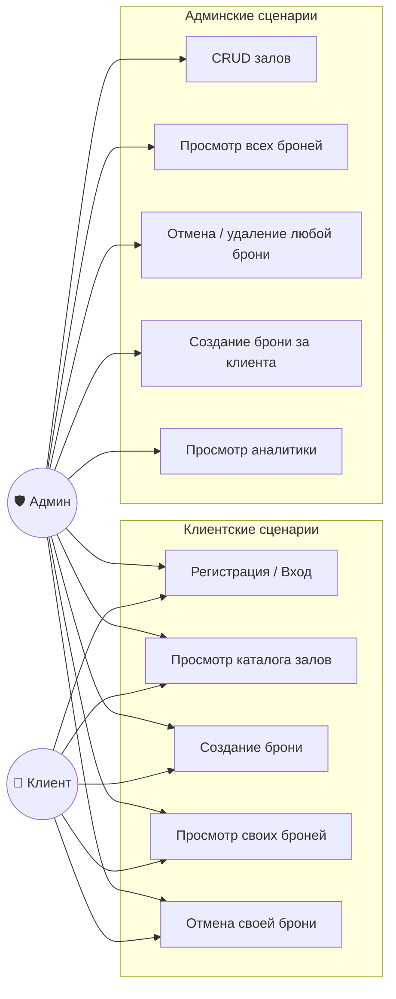
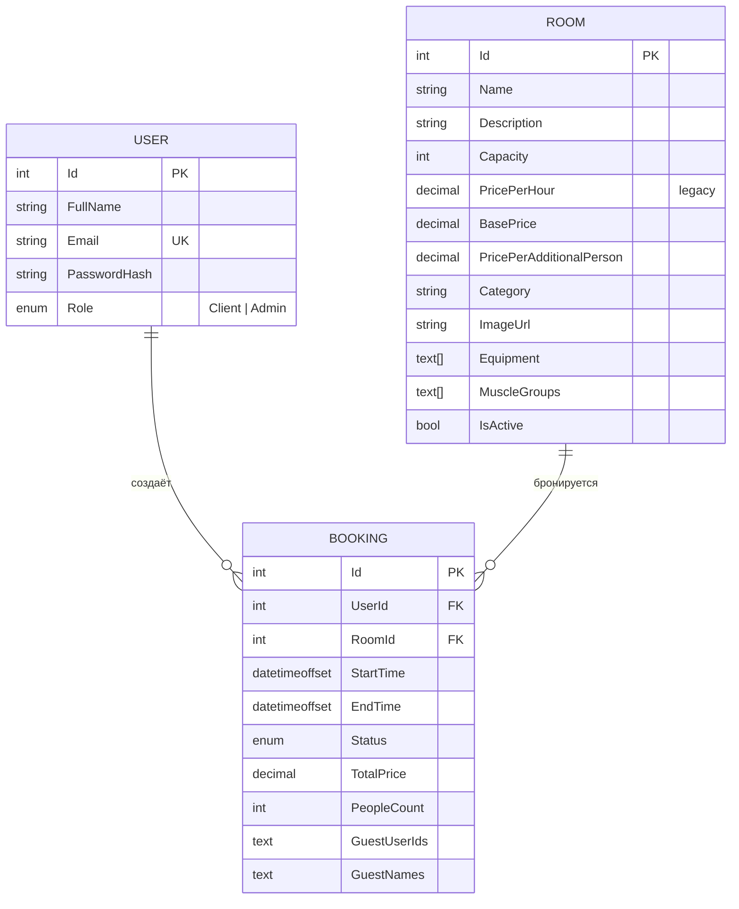

# Архитектура PrivateGym

Документ описывает системную модель приложения: роли, данные, компоненты, ключевые сценарии и состояния брони.

## Содержание
1. [Use Case](#1-use-case)
2. [ER-модель](#2-er-модель)
3. [Компоненты](#3-компоненты)
4. [Sequence: регистрация и вход](#4-sequence-регистрация-и-вход)
5. [Sequence: создание брони клиентом](#5-sequence-создание-брони-клиентом)
6. [Sequence: создание брони админом](#6-sequence-создание-брони-админом)
7. [Sequence: фоновое обновление статусов](#7-sequence-фоновое-обновление-статусов)
8. [Состояния Booking](#8-состояния-booking)
9. [Activity: процесс бронирования глазами клиента](#9-activity-процесс-бронирования-глазами-клиента)

---

## 1. Use Case


Пояснение. На схеме показано, кто и что может делать в системе. Администратор — это "продвинутый пользователь": ему доступны все функции клиента (например, забронировать зал для себя), плюс он может управлять каталогом залов, создавать брони для других людей и смотреть статистику. Обычный клиент видит только свои брони и не может попасть в админку.

2. ER-модель

Пояснение. Здесь показано, как устроена база данных. Есть три главные таблицы: Пользователи, Залы и Брони. У одного пользователя может быть много броней, и у одного зала тоже может быть много броней. Время хранится с учетом часовых поясов, чтобы система работала корректно в любой точке мира. Для простоты данные о гостях пока хранятся в виде текстовой строки.

3. Компоненты
```mermaid
graph TB
    subgraph Client_Layer [🌐 Клиентский слой]
        Browser[Браузер<br/>HTML + Vanilla JS<br/>+ ApexCharts]
    end

    subgraph App_Layer [⚙️ ASP.NET Core 8]
        API[Web API Controllers<br/>Auth / Rooms / Bookings / Admin]
        Auth[JWT Auth + BCrypt]
        BG[BookingStatusUpdateService<br/>BackgroundService]
    end

    subgraph Data_Layer [🗄️ Слой данных]
        EF[EF Core 8]
        PG[(PostgreSQL 15)]
    end

    Browser -- HTTPS + JWT --> API
    API --> Auth
    API --> EF
    Auth --> EF
    BG --> EF
    EF --> PG
   ```
Пояснение. Общая картина того, как всё работает вместе. Пользователь работает в браузере. Браузер отправляет запросы на сервер (API). Сервер проверяет права доступа (Auth), общается с базой данных (PostgreSQL) и иногда запускает фоновые задачи (например, чтобы автоматически завершать старые брони).

4. Sequence: регистрация и вход
```mermaid
sequenceDiagram
    autonumber
    actor U as Клиент
    participant API as AuthController
    participant DB as PostgreSQL
    U->>API: POST /auth/register (email, password, fullName)
    API->>DB: SELECT user WHERE Email = ?
    DB-->>API: пусто
    API->>API: BCrypt.HashPassword()
    API->>DB: INSERT User (Role = Client)
    DB-->>API: OK
    API-->>U: 200 "Регистрация успешна"
    U->>API: POST /auth/login (email, password)
    API->>DB: SELECT user WHERE Email = ?
    DB-->>API: User
    API->>API: BCrypt.Verify()
    API->>API: JWT (id, role, exp = 7d)
    API-->>U: 200 { token, role, userId, fullName }
    U->>U: localStorage.setItem("token")
   ```
Пояснение. Как проходит вход в систему. При регистрации пароль не сохраняется в открытом виде — он шифруется. Когда пользователь вводит логин и пароль, сервер сверяет их с базой и выдает цифровой "ключ" (токен). Браузер сохраняет этот ключ и показывает его при каждом следующем действии, чтобы не вводить пароль заново.

5. Sequence: создание брони клиентом
Проверка и вставка выполняются в одной сериализуемой транзакции. Это исключает гонку "два клиента одновременно видят слот свободным и оба вставляют бронь".

sequenceDiagram
    autonumber
    actor C as Клиент
    participant API as BookingsController
    participant DB as PostgreSQL

    C->>API: POST /bookings {roomId, start, end, people}
    API->>API: Валидация (start < end, start > now, 1 ≤ people ≤ capacity)
    API->>DB: Найти Room
    DB-->>API: Room
    API->>API: Рассчитать TotalPrice на сервере

    API->>DB: BEGIN ISOLATION LEVEL SERIALIZABLE

    API->>DB: SELECT booking WHERE RoomId=? AND Status!=Cancelled AND overlap
    alt Пересечение есть
        DB-->>API: конфликт
        API->>DB: ROLLBACK
        API-->>C: 409 Conflict
    else Свободно
        DB-->>API: пусто
        API->>DB: INSERT Booking (Status=Confirmed)
        API->>DB: COMMIT
        DB-->>API: OK
        API-->>C: 200 BookingResponse
    end
    ```
Пояснение. Процесс бронирования зала. Главная фишка здесь — защита от двойного бронирования. Если два человека одновременно нажмут кнопку "Забронировать" на одно и то же время, сервер пропустит только одного. Второй получит сообщение об ошибке, что слот уже занят. Цена всегда считается на сервере, чтобы её нельзя было подделать через браузер.

6. Sequence: создание брони админом
```mermaid
sequenceDiagram
    autonumber
    actor A as Админ
    participant API as AdminController
    participant DB as PostgreSQL
    A->>API: POST /admin/bookings {userId, roomId, start, end, guests}
    API->>API: Валидация
    API->>DB: Найти Room (должен быть IsActive)
    DB-->>API: Room
    API->>DB: Проверить, что UserId существует
    DB-->>API: User
    API->>API: Рассчитать TotalPrice на сервере

    API->>DB: BEGIN ISOLATION LEVEL SERIALIZABLE
    API->>DB: Проверить пересечение
    alt Зал занят
        API->>DB: ROLLBACK
        API-->>A: 409 Conflict
    else Свободен
        API->>DB: INSERT Booking (Status=Confirmed, UserId=клиента)
        API->>DB: COMMIT
        API-->>A: 200 { Id }
    end
   ```
Пояснение. Админ может создать бронь от имени клиента. Система сначала проверяет, что такой клиент действительно существует в базе, а затем создает бронь по тем же строгим правилам безопасности, что и для обычного пользователя. Админ также может сразу добавить гостей к этой брони.

7. Sequence: фоновое обновление статусов
```mermaid
sequenceDiagram
    autonumber
    participant BG as BookingStatusUpdateService
    participant DB as PostgreSQL
    loop Каждые 5 минут
        BG->>DB: SELECT WHERE Status=Confirmed AND EndTime < NOW
        DB-->>BG: expiredBookings[]
        BG->>BG: Status = Completed
        BG->>DB: SaveChanges
        BG->>BG: LogInformation(updated count)
    end
 ```
Пояснение. Автоматический помощник. Сервер каждые 5 минут проверяет базу данных. Если время брони уже прошло, а статус всё еще "Подтверждено", он автоматически меняет его на "Завершено". Благодаря этому администратору не нужно вручную закрывать каждую бронь, а статистика всегда остается точной.

8. Состояния Booking
```mermaid
stateDiagram-v2
    [*] --> Confirmed: создание клиентом / админом
    [*] --> Pending: (резерв, не используется)

    Pending --> Confirmed: подтверждение админом
    Pending --> Cancelled

    Confirmed --> Completed: EndTime прошёл (BackgroundService)
    Confirmed --> Cancelled: отмена клиентом / админом
    Confirmed --> NoShow: админ вручную

    Completed --> [*]
    Cancelled --> [*]
    NoShow --> [*]

    note right of Pending
        В текущей реализации не создаётся.
        Зарезервировано под сценарий
        «предзаявка с подтверждением».
    end note
    note right of Confirmed
        Основной рабочий статус.
        Участвует в проверке пересечений.
    end note
   ```
Пояснение. Жизненный путь брони. Сначала она всегда создается в статусе "Подтверждено". Дальше её судьба может сложиться по-разному: она может стать "Завершенной" (когда время прошло), "Отмененной" (если клиент передумал) или "Не пришел" (если админ вручную отметил прогул). Статус "В ожидании" пока не используется, он оставлен на будущее.

9. Activity: процесс бронирования глазами клиента
```mermaid
flowchart TD
    A([Начало]) --> B[Выбор зала из каталога]
    B --> C[Выбор даты]
    C --> D["GET /rooms/{id}/schedule"]
    D --> E{"Есть свободные слоты?"}
    E -- Нет --> C
    E -- Да --> F[Выбор одного или нескольких диапазонов]
    F --> G[Указание числа гостей]
    G --> H[Клиент видит итоговую цену]
    H --> I[Нажатие «Забронировать»]
    I --> J{"Для каждого диапазона:<br/>POST /bookings"}
    J -- 409 Conflict --> K[Ошибка: слот занят]
    K --> C
    J -- 200 OK --> L[Сервер пересчитывает цену]
    L --> M[Сохранение в БД]
    M --> N[Бронь в «Мои бронирования»]
    N --> O([Конец])
   ```
Пояснение. Пошаговая инструкция того, что делает клиент. Сначала он выбирает зал и дату, видит свободные часы, отмечает нужные (можно выбрать как один подряд идущий интервал, так и несколько разных), указывает гостей и нажимает кнопку. Если за время выбора кто-то успел занять эти часы, система вернет ошибку и попросит выбрать другое время.
