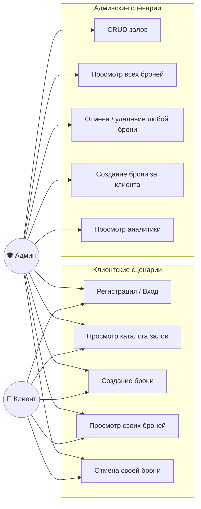
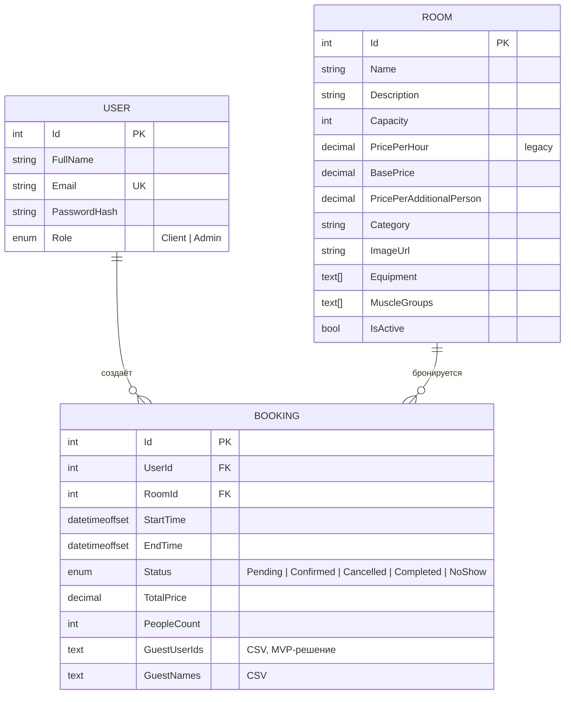
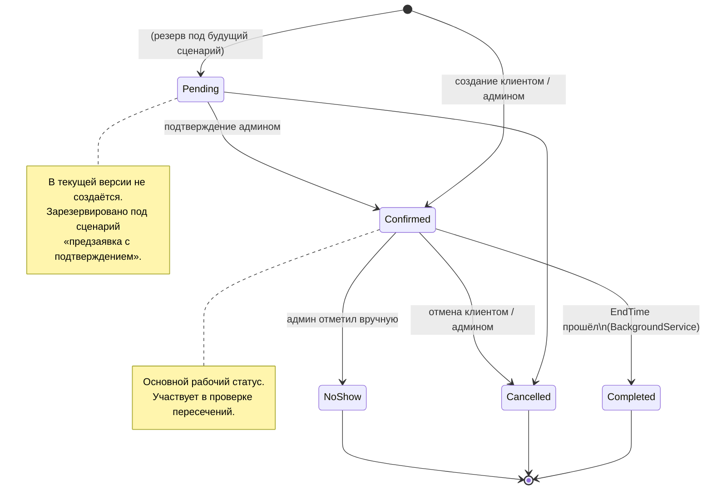

# 🏋️ PrivateGym

**Система управления бронированием частных тренировочных залов**

Full-stack веб-приложение для автоматизации бронирования залов. Исключает человеческий фактор, предотвращает двойные брони, даёт администраторам аналитику и инструменты управления.

---

## 🚀 Стек технологий

| Категория | Технологии |
| :--- | :--- |
| **Backend** | C# 12, ASP.NET Core Web API (.NET 8, LTS), Entity Framework Core 8 |
| **База данных** | PostgreSQL 15 (нативные типы `text[]` для массивов) |
| **Безопасность** | JWT (JSON Web Tokens), BCrypt (хеширование паролей) |
| **Frontend** | HTML5, CSS3, Vanilla JavaScript, ApexCharts |
| **Инфраструктура** | Docker, Docker Compose, Git |

---

## 📐 Архитектура и проектирование

Полный набор диаграмм с пояснениями — в [`/docs/architecture.md`](/PrivateGym.Api/docs/architecture.md). Ключевые схемы:

### Use Case — роли и сценарии



### ER-модель



### Жизненный цикл брони



Остальные схемы (компоненты, sequence, activity) → [`/docs/architecture.md`](/PrivateGym.Api/docs/architecture.md).

---

## ⚙️ Ключевые инженерные решения

### 🔒 Безопасность и аутентификация
- **Ролевая модель:** разделение доступа (`Client` / `Admin`) через `[Authorize(Roles = "...")]`.
- **Хеширование паролей:** `BCrypt.Net.BCrypt.HashPassword` + verify при логине. Пароли в открытом виде не хранятся.
- **JWT:** глобальная валидация (`issuer`, `audience`, `lifetime`, `signing key`) в `Program.cs` через `AddJwtBearer`. Срок жизни токена — 7 дней.

### 🛡️ Защита от двойного бронирования
- **Проверка пересечений:** классическая логика overlap (`Start1 < End2 AND End1 > Start2`), отменённые брони не блокируют слот.
- **Сериализуемая транзакция:** проверка и вставка выполняются в одной `SERIALIZABLE`-транзакции. Два одновременных запроса на один слот не смогут оба увидеть его свободным — второй получит `409 Conflict`. Это защищает от классической гонки check-then-act.
- **Серверный расчёт цены:** итоговая стоимость пересчитывается исключительно на сервере по формуле `(BasePrice + PricePerAdditionalPerson * (PeopleCount - 1)) * Hours`. Любые манипуляции с ценой на клиенте игнорируются.

### 📊 Аналитика
- **Метрики «на лету»** в `AdminController.GetStatistics` через `SumAsync` / `CountAsync` — без выгрузки всей таблицы в память.
- **Корректное сравнение периодов:** % изменения считается сопоставлением с **аналогичным по длительности** отрезком предыдущего периода. Если сегодня 11 ноября, текущий период «1–11 ноября» сравнивается с «1–11 октября», а не с полным октябрём.
- **График ограничен 31 днём:** при выборе большого периода на графике показываются последние 31 день, чтобы бары не превращались в кашу. Метрики при этом считаются по всему диапазону.

### ⏰ Фоновые процессы
- **`BookingStatusUpdateService`** — наследник `BackgroundService`. Каждые 5 минут в отдельном scope DI находит истёкшие `Confirmed`-брони и переводит их в `Completed`. Работает параллельно с HTTP-запросами, не блокирует их.

### ⚡ Оптимизация запросов
- Фильтрация и пагинация в `RoomsController` применяются на уровне `IQueryable` **до** материализации — в память попадает только текущая страница.
- Универсальная обёртка `PaginatedResult<T>` (`Items`, `TotalCount`, `Page`, `PageSize`, `TotalPages`, `HasNextPage`).

---

## 🏃 Быстрый старт

### Через Docker Compose (рекомендуется)

```bash
git clone https://github.com/<username>/PrivateGym.git
cd PrivateGym
docker compose up -d
```

Через ~30 секунд приложение доступно по адресу **http://localhost:5000/landing.html**.

### Тестовый аккаунт администратора

Для проверки административного функционала уже создан пользователь:

| Поле | Значение |
| :--- | :--- |
| **Email** | `admin@privategym.local` |
| **Пароль** | `Admin123!` |

> ⚠️ Эти креды — **только для локального демо**. В продакшене обязательно сменить пароль (или удалить пользователя и создать нового с ролью `Admin` через SQL).

### Аккаунт клиента

Регистрируется за 30 секунд на странице `/register.html`. Отдельных предусловий нет.

### Запуск без Docker (для разработки)

```bash
# 1. Поднять PostgreSQL 15+ и создать БД PrivateGymDb
# 2. Скопировать шаблон конфигурации и вписать свои креды
cp appsettings.Example.json appsettings.Development.json

# 3. Применить миграции
dotnet ef database update

# 4. Запустить приложение
dotnet run --project PrivateGym.Api
```

---

## 📡 API-эндпоинты

| Метод | Эндпоинт | Доступ | Описание |
| :--- | :--- | :--- | :--- |
| POST | `/api/auth/register` | Аноним | Регистрация (только `Client`) |
| POST | `/api/auth/login` | Аноним | Вход → `{ token, role, userId, fullName }` |
| GET | `/api/rooms` | Аноним | Каталог с фильтрами и пагинацией |
| GET | `/api/rooms/{id}` | Аноним | Конкретный зал |
| GET | `/api/rooms/{id}/schedule?date=YYYY-MM-DD` | Аноним | Занятые слоты на дату |
| POST | `/api/bookings` | Auth | Создать бронь от своего имени |
| GET | `/api/bookings/my` | Auth | Свои брони (+ фильтр по датам) |
| DELETE | `/api/bookings/{id}` | Auth | Отменить свою бронь |
| GET | `/api/admin/rooms` | Admin | Все залы (включая неактивные) |
| POST | `/api/admin/rooms` | Admin | Создать зал |
| PUT | `/api/admin/rooms/{id}` | Admin | Обновить зал |
| DELETE | `/api/admin/rooms/{id}` | Admin | Удалить зал |
| GET | `/api/admin/bookings` | Admin | Все брони |
| POST | `/api/admin/bookings` | Admin | Создать бронь за клиента |
| PUT | `/api/admin/bookings/{id}/status` | Admin | Сменить статус |
| DELETE | `/api/admin/bookings/{id}` | Admin | Отменить бронь |
| DELETE | `/api/admin/bookings/{id}/delete` | Admin | Удалить бронь навсегда |
| GET | `/api/admin/statistics` | Admin | Метрики + данные для графика |
| GET | `/api/admin/users?search=` | Admin | Поиск пользователей |

---

## 📁 Структура проекта

```text
PrivateGym.Api/
├── Controllers/          # Точки входа API (Auth, Bookings, Rooms, Admin)
├── Data/                 # AppDbContext
├── DTOs/                 # Объекты передачи данных
├── Models/               # Сущности (User, Room, Booking)
├── Services/             # BookingStatusUpdateService (фоновый воркер)
├── wwwroot/              # HTML / CSS / JS
├── docs/                 # Диаграммы и системная аналитика
├── Program.cs            # DI, Middleware, JWT, CORS
└── appsettings.json      # Конфигурация
```

---

## 📸 Скриншоты

| Каталог залов | Бронирование | Дашборд админа |
| :---: | :---: | :---: |
| _(скоро)_ | _(скоро)_ | _(скоро)_ |

> Скриншоты будут добавлены после финального прогона интерфейса.

---

## ⚠️ Известные ограничения

- **Статус `Pending` не используется.** Бронь создаётся сразу как `Confirmed` — и клиентом, и админом. Статус зарезервирован на будущее (сценарий «заявка на подтверждение»).
- **Нет refresh-токенов.** JWT живёт 7 дней, после истечения — повторный логин.
- **Нет автотестов.** Все сценарии проверялись вручную.

---

## 🛣️ Планы по улучшению

- Автотесты (xUnit + Testcontainers) — покрыть создание/отмену брони и расчёт статистики.

---
